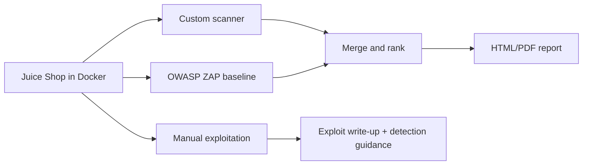

# AttackLens Red: Automated Web Attack Simulation and Security Assessment
# Part of a series: [AttackLens](https://github.com/JayPatel199/attacklens) (detection) · **AttackLens Red** (attack simulation, this repo) · [AttackLens Auto](https://github.com/JayPatel199/AttackLens-Auto) (automation)

The offensive counterpart to [AttackLens](https://github.com/JayPatel199/attacklens), my blue-team detection project. This project finds and exploits weaknesses in a deliberately vulnerable web app (OWASP Juice Shop), then documents how each attack would be detected and fixed.


## Results at a glance
- Custom Python scanner with 4 check types (security headers, cookie flags, exposed paths, server banner)
- OWASP ZAP baseline scan integrated and merged into one severity-ranked HTML report
- 3 vulnerabilities manually exploited: SQL injection, XSS, sensitive file exposure
- Every finding mapped to OWASP Top 10 and MITRE ATT&CK
- GitHub Actions pipeline runs the scan on every push
- Sample report: [reports/sample_report.pdf](reports/sample_report.pdf)

## How it works


## Red team and blue team
| | AttackLens (Blue) | AttackLens Red |
|---|---|---|
| Question | Can I detect the attack? | Can I find and exploit the weakness? |
| Shared language | MITRE ATT&CK | MITRE ATT&CK |

Each exploit write-up includes a "How the blue team would catch it" section.

## Run it yourself
```bash
git clone https://github.com/JayPatel199/AttackLens-Red.git
cd AttackLens-Red
pip install requests jinja2
docker run -d -p 3000:3000 --name juice bkimminich/juice-shop
python scanner.py
python report.py
```

## Limitations
- The ZAP baseline scan is passive; an active scan would find more
- Only run against systems you own or have permission to test
- MITRE mappings for some web findings are my own judgment

## What I learned
A missing security header doesn't guarantee an attack will succeed, but it removes a layer of defense a browser would otherwise provide automatically. Manual exploitation matters because an automated scanner only flags a *possible* weakness; actually logging in with a SQL injection payload proves it's real and shows its full impact. Detection and attack are two sides of the same coin: every exploit I performed here has a matching log signature that AttackLens (my blue-team project) could be trained to catch.

Author: Jay Patel
